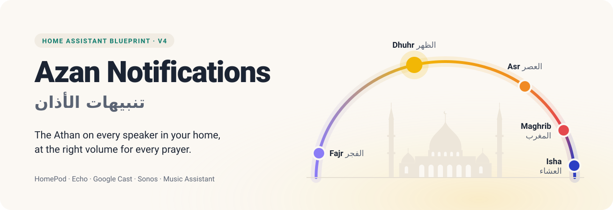

# **🏠 Home Assistant Blueprints**

### by [**Shady Nafie — Smart Tech Arabic**](https://smarttecharabic.com)

A **curated collection** of high-quality, ready-to-use **Home Assistant blueprints** to build a smarter, personalized home automation experience — **with just a few clicks!**

🔧 Created by [Shady Nafie](https://smarttecharabic.com), a passionate smart home enthusiast and content creator behind the [Smart Tech Arabic YouTube channel](https://www.youtube.com/@smarttecharabic), where he shares practical Home Assistant tutorials and ideas to help Arabic-speaking users simplify their automations and enjoy smarter living.

---

## ⭐ Featured: Azan Notifications V4

<a href="./blueprints/automation/smarttecharabic/azan-notifications/README.md">
  <picture>
    <source media="(prefers-color-scheme: dark)" srcset="docs/images/azan-banner-dark.svg">
    
  </picture>
</a>

The Athan on every speaker in your home (HomePod, Echo, Google Cast, Sonos), with a voice for each prayer, each speaker at its own volume for each prayer, silence after the Athan, spoken reminders and phone notifications in English and Arabic.

  

[Read more](./blueprints/automation/smarttecharabic/azan-notifications/README.md) · [Website](https://shadynafie.github.io/home-assistant-blueprints/) · [Listen to the voices](https://shadynafie.github.io/home-assistant-blueprints/azan-voices.html)

---

## 📚 All Blueprints

### 🕌 [Azan Notifications](./blueprints/automation/smarttecharabic/azan-notifications/README.md)

Plays the Athan on your speakers at each of the five daily prayers, each speaker at its own volume for each prayer, with spoken reminders and phone notifications.

### 👥 [Person Zone Monitor](./blueprints/automation/smarttecharabic/people-tracking/README.md)

Monitor multiple people across zones and trigger custom actions when they enter, leave, or jump between zones — great for family and presence-based automation.

### 📖 [Before Maghrib Quran](./blueprints/automation/smarttecharabic/before-maghrib/README.md)

Plays the Quran you choose on your speakers before Maghrib, from a radio station, your Music Assistant library, a web link or an Alexa playlist, and stops before the Athan.

### 🔗 [Sync On/Off](./blueprints/automation/smarttecharabic/sync-states/README.md)

Keeps two or more lights, switches or fans on or off together, so a smart switch can drive smart bulbs that are always powered.

---

## 🌐 Learn More & Get Support

* 📺 **YouTube Channel**: [Smart Tech Arabic](https://www.youtube.com/@smarttecharabic) — tutorials, walkthroughs, and smart home reviews in Arabic
* 🌍 **Website**: [smarttecharabic.com](https://smarttecharabic.com) — book consultations, explore articles, and download planning tools
* 💬 **Facebook Group**: Join our growing community of Arabic-speaking smart home enthusiasts: [Smart Tech Arabic Community](https://www.facebook.com/groups/smarttecharabic)

---

## 🤝 Contribute

Contributions, suggestions, and bug reports are welcome. Please feel free to open issues or pull requests to help make these blueprints even better for the community.
