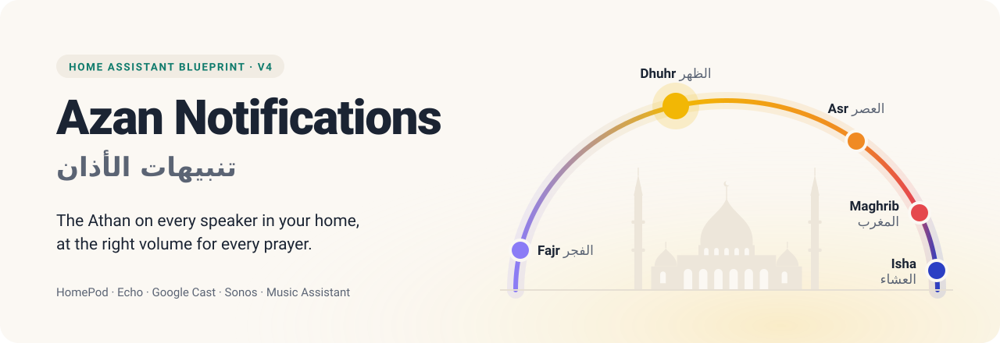
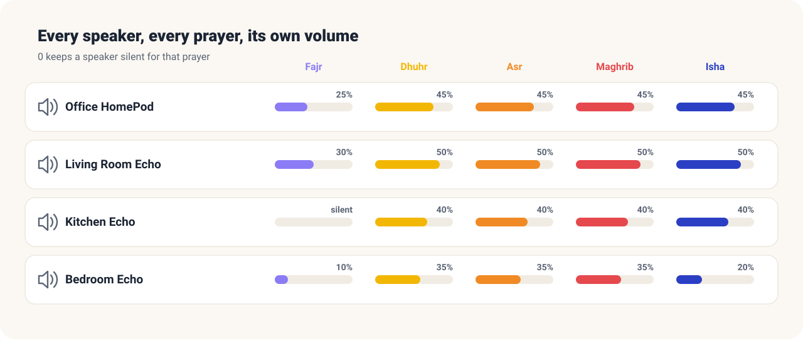
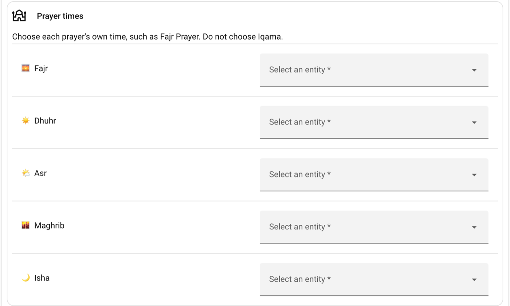
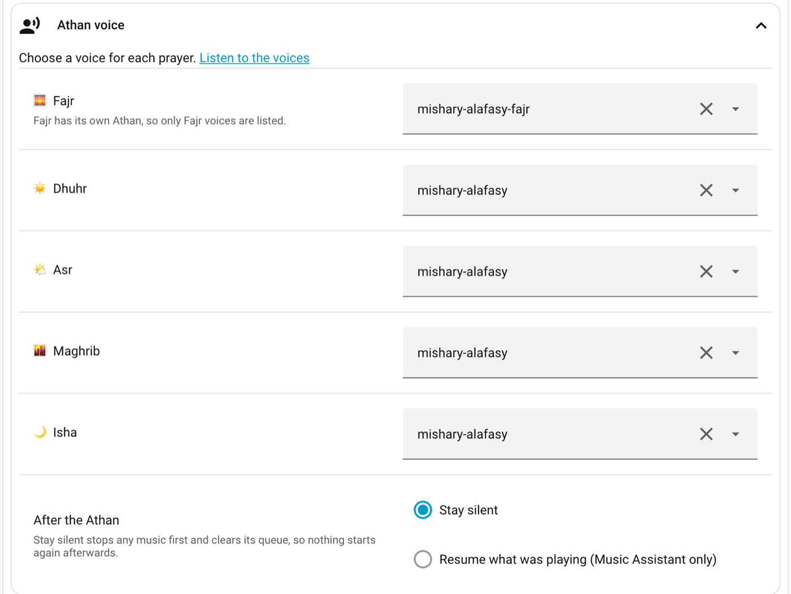
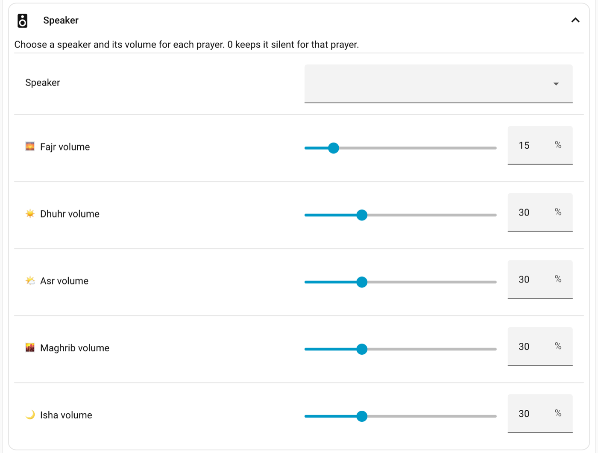
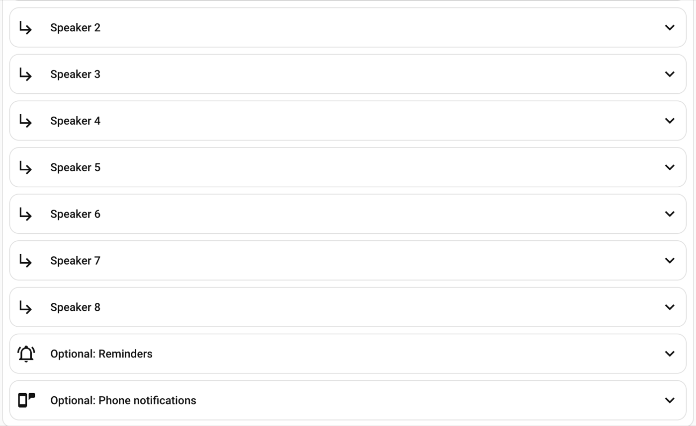
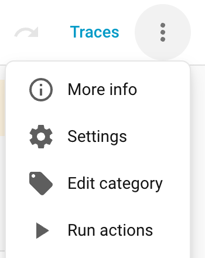

<picture>
  <source media="(prefers-color-scheme: dark)" srcset="../../../../docs/images/azan-banner-dark.svg">
  
</picture>

  

  <a href="https://shadynafie.github.io/home-assistant-blueprints/"><b>Website</b></a> ·
  <a href="https://shadynafie.github.io/home-assistant-blueprints/azan-voices.html"><b>Listen to the voices</b></a> ·
  <a href="#how-to-use-it"><b>How to use it</b></a> ·
  <a href="#arabic"><b>العربية</b></a>

---

## What it does

| | |
|---|---|
| 🕌 **The Athan at every prayer** | Plays on time at Fajr, Dhuhr, Asr, Maghrib and Isha, from any prayer times integration. |
| 🎙️ **A voice for each prayer** | Over 40 reciters to choose from, and Fajr always plays a real Fajr Athan. |
| 🔊 **Each speaker, its own volume** | Set every speaker's volume for every prayer. Quieter in the bedroom at Fajr, louder in the kitchen at Maghrib, or silent where you choose. |
| 🤫 **Silence after the Athan** | Music stops before the Athan and does not come back afterwards. |
| ⏰ **Reminders before the prayer** | An optional spoken reminder on the speakers, minutes before the Athan. |
| 📱 **Phone notifications** | In English and Arabic, at the Athan and with each reminder. |

<picture>
  <source media="(prefers-color-scheme: dark)" srcset="../../../../docs/images/azan-volumes-dark.svg">
  
</picture>

Works with **HomePod**, **Amazon Echo**, **Google Cast** and **Sonos**, and you can mix them. It works best through [Music Assistant](https://www.music-assistant.io/): the Athan plays as an announcement, and each speaker goes back to its own volume afterwards.

---

## How to use it

**1. Before you start**

- Install a prayer times integration, such as [MAWAQIT](https://github.com/mawaqit/home-assistant) or Islamic Prayer Times.
- Recommended: add your speakers to [Music Assistant](https://www.music-assistant.io/). For Echos, use [Alexa Media Player](https://github.com/alandtse/alexa_media_player) instead.

**2. Import the blueprint** with the button at the top, then choose **Create automation**.

**3. Prayer times.** Choose each prayer's own time, such as **Fajr Prayer**. Do not choose Iqama, or the Athan will play at the Iqama time.

**4. Athan voice.** Choose a voice for each prayer. [Listen to them first](https://shadynafie.github.io/home-assistant-blueprints/azan-voices.html). Fajr lists Fajr Athans only. **After the Athan** decides what happens to music: **Stay silent** stops it and clears its queue, so nothing starts again.

**5. Speaker.** Choose a speaker and set its volume for each prayer. **0 keeps it silent for that prayer.**

**6. More speakers.** Open **Speaker 2** and so on, up to 8 speakers. Then save.

**7. Test it.** Open the **⋮** menu at the top right and choose **Run actions**. It plays the Dhuhr voice at each speaker's Dhuhr volume, after a sample reminder if reminders are on.

### Optional: reminders

Tick the prayers that get a reminder and set **Minutes before the Athan**. The spoken message can use `{prayer}` and `{minutes}`, which are filled in for you, for example *"Salam, {prayer} prayer is in {minutes} minutes."* Choose a **Voice for spoken reminders** too. Reminders play at each speaker's volume for that prayer.

### Optional: phone notifications

Choose the phones and the prayers that notify. The messages can use `{emoji}`, `{prayer}`, `{prayer_ar}` and `{minutes}`. The defaults read:

> 🌆 Time for Maghrib prayer – حان الآن موعد صلاة المغرب
> ⏰ 🌆 Maghrib prayer is in 15 minutes – صلاة المغرب بعد 15 دقيقة

### Good to know

- Your speakers need internet, because the voices play from GitHub.
- After you pick a voice, the box shows its short name, such as `abdul-basit`. This is normal.
- Speakers with the same volume play together. If the same speaker is chosen twice, its first panel counts.
- **Resume what was playing** works on Music Assistant speakers only.
- **Got Echos? Choose them through [Alexa Media Player](https://github.com/alandtse/alexa_media_player), not Music Assistant.** Music Assistant sends several requests to Amazon for every Echo, so with two or more Echos Amazon starts refusing them: the Echos stay silent, and the Athan on your other speakers can break up and stop. Through Alexa Media Player, all your Echos take one request.
- Echos in Music Assistant cannot tell Home Assistant when you stop them by voice, so an old queue could start again after an announcement. The blueprint clears that queue before each reminder, so it cannot.
- On Echo through Alexa Media Player, Home Assistant cannot see whether it played. Test it by ear.
- To use your own sound, type its `https` MP3 link in any voice box. For Echo through Alexa Media Player it must be MP3, 48 kbps, 22050 Hz, up to 240 seconds.

### Coming from version 3?

V4 is a new blueprint, so your V3 automation keeps working exactly as it is. To move, import V4 with the button above, create a new automation with your speakers and volumes, then delete the old one.

---

## ماذا يفعل

- 🕌 **الأذان في كل صلاة:** يعمل في وقته للفجر والظهر والعصر والمغرب والعشاء، من أي إضافة لمواقيت الصلاة.
- 🎙️ **صوت لكل صلاة:** أكثر من 40 مؤذنًا للاختيار، والفجر يُشغّل دائمًا أذان الفجر الخاص به.
- 🔊 **لكل سماعة مستوى صوتها:** حدّد مستوى صوت كل سماعة في كل صلاة. أهدأ في غرفة النوم وقت الفجر، وأعلى في المطبخ وقت المغرب، أو صامتة حيث تريد.
- 🤫 **هدوء بعد الأذان:** تتوقف الموسيقى قبل الأذان ولا تعود بعده.
- ⏰ **تذكير قبل الصلاة:** تذكير صوتي اختياري على السماعات قبل الأذان بدقائق.
- 📱 **إشعارات الهاتف:** بالعربية والإنجليزية، عند الأذان ومع كل تذكير.

يعمل مع **HomePod** و**Amazon Echo** و**Google Cast** و**Sonos**، ويمكنك الجمع بينها. ويعمل بأفضل شكل عبر [Music Assistant](https://www.music-assistant.io/): يُشغَّل الأذان كإعلان، ثم تعود كل سماعة إلى مستوى صوتها.

## طريقة الاستخدام

**١. قبل البدء**

- ثبّت إضافة لمواقيت الصلاة، مثل [MAWAQIT](https://github.com/mawaqit/home-assistant) أو Islamic Prayer Times.
- يُفضَّل إضافة السماعات إلى [Music Assistant](https://www.music-assistant.io/). أما سماعات Echo فاستخدم لها [Alexa Media Player](https://github.com/alandtse/alexa_media_player).

**٢. استورد القالب** بالزر في أعلى الصفحة، ثم اختر **Create automation**.

**٣. Prayer times:** اختر وقت كل صلاة نفسها، مثل **Fajr Prayer**. لا تختر Iqama، وإلا سيعمل الأذان في وقت الإقامة.

**٤. Athan voice:** اختر صوتًا لكل صلاة، و[استمع إلى الأصوات أولًا](https://shadynafie.github.io/home-assistant-blueprints/azan-voices.html). قائمة الفجر فيها أذان الفجر فقط. ويحدد خيار **After the Athan** ما يحدث للموسيقى: **Stay silent** يوقفها ويمسح قائمة التشغيل حتى لا يعود شيء.

**٥. Speaker:** اختر السماعة وحدد مستوى صوتها لكل صلاة. **القيمة 0 تجعلها صامتة في تلك الصلاة.**

**٦. سماعات أخرى:** افتح **Speaker 2** وما بعدها، حتى 8 سماعات. ثم احفظ.

**٧. جرّبه:** افتح قائمة **⋮** أعلى الصفحة واختر **Run actions**. يُشغّل صوت الظهر بمستوى صوت الظهر لكل سماعة، بعد تذكير تجريبي إذا كانت التذكيرات مفعّلة.

### اختياري: التذكير

اختر الصلوات التي تريد لها تذكيرًا وحدد **Minutes before the Athan**. يمكن أن تحتوي الرسالة الصوتية على `{prayer}` و`{minutes}`، وتُملأ تلقائيًا. واختر أيضًا **Voice for spoken reminders**. يعمل التذكير بمستوى صوت كل سماعة في تلك الصلاة.

### اختياري: إشعارات الهاتف

اختر الهواتف والصلوات التي يصل لها إشعار. يمكن أن تحتوي الرسائل على `{emoji}` و`{prayer}` و`{prayer_ar}` و`{minutes}`.

### معلومات مفيدة

- تحتاج السماعات إلى إنترنت، لأن الأصوات تُشغَّل من GitHub.
- بعد اختيار الصوت تعرض الخانة اسمه المختصر، مثل `abdul-basit`. وهذا طبيعي.
- السماعات التي لها نفس مستوى الصوت تعمل معًا. وإذا اخترت نفس السماعة مرتين، يُعتمد أول قسم.
- خيار **Resume what was playing** يعمل مع سماعات Music Assistant فقط.
- **لديك سماعات Echo؟ اخترها عبر [Alexa Media Player](https://github.com/alandtse/alexa_media_player) وليس Music Assistant.** يرسل Music Assistant عدة طلبات إلى Amazon لكل سماعة Echo، فإذا كان لديك اثنتان أو أكثر ترفضها Amazon: تبقى سماعات Echo صامتة، وقد يتقطع الأذان على باقي السماعات ويتوقف. أما عبر Alexa Media Player فيكفي طلب واحد لكل سماعات Echo.
- لا تستطيع سماعات Echo في Music Assistant إخبار Home Assistant عندما توقفها بصوتك، فقد تعود قائمة تشغيل قديمة بعد الإعلان. لذلك يمسح القالب هذه القائمة قبل كل تذكير.
- مع Echo عبر Alexa Media Player لا يستطيع Home Assistant معرفة هل شُغّل الأذان أم لا، فتأكد بنفسك عن طريق السمع.
- لاستخدام صوتك الخاص، اكتب رابط MP3 يبدأ بـ `https` في خانة الصوت. ومع Echo عبر Alexa Media Player يجب أن يكون الملف MP3 بجودة 48 kbps و22050 Hz ولا يزيد عن 240 ثانية.

### هل تستخدم الإصدار 3؟

الإصدار 4 قالب جديد، لذلك تظل أتمتة الإصدار 3 تعمل كما هي. للانتقال، استورد الإصدار 4 بالزر في الأعلى، وأنشئ أتمتة جديدة بسماعاتك ومستويات الصوت، ثم احذف القديمة.

---

  By <a href="https://smarttecharabic.com">Shady Nafie, Smart Tech Arabic</a> · <a href="https://www.youtube.com/@smarttecharabic">YouTube</a>

Blueprint: MIT License. Audio is not covered by the MIT License: voices come from <a href="https://audio.islamweb.net/audio/index.php?Gtype=1&page=AudioGroup">IslamWeb</a>, the <a href="https://archive.org">Internet Archive</a>, <a href="https://github.com/abodehq/Athan-MP3">Athan-MP3</a> and <a href="https://www.islamcan.com/audio/adhan/index.shtml">IslamCan</a>, converted to Echo's format. Version 3 of the blueprint remains available as <code>azan_notifications.yaml</code>.
