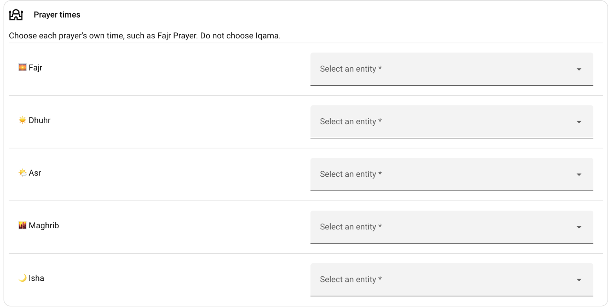
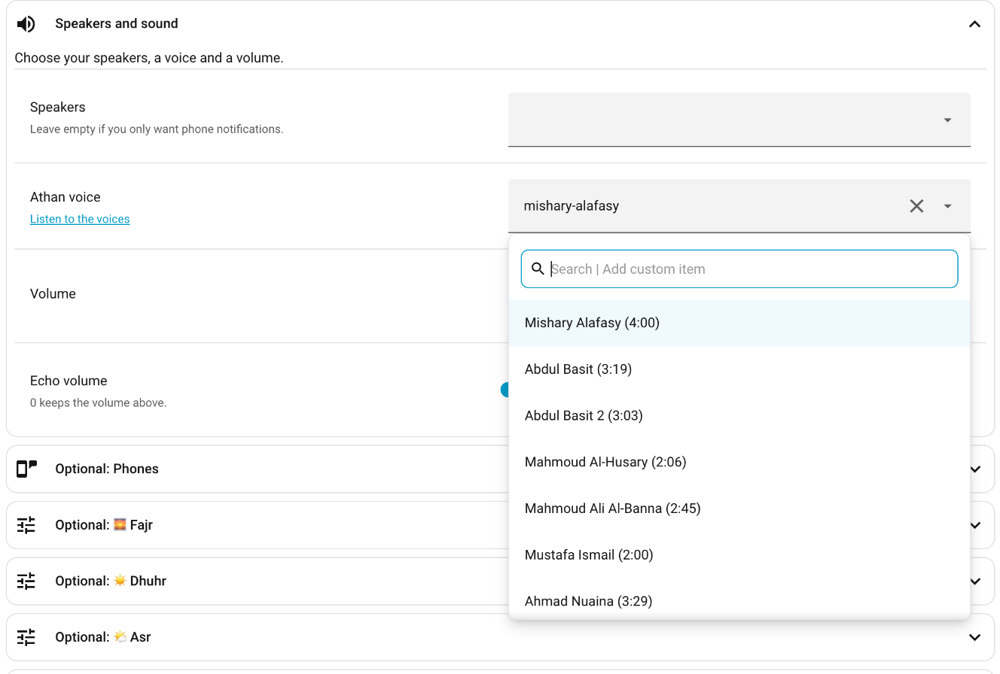
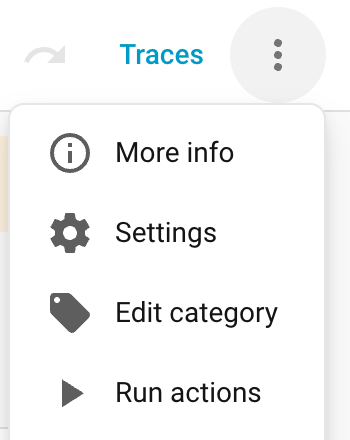
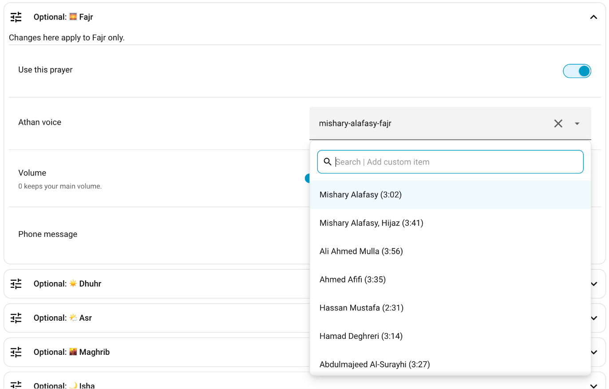

# Azan Notifications

Plays the Athan on your speakers at every prayer time, and can notify your phones.

[English](#how-to-use-it) · [العربية](#arabic)

---

## How to use it

**1. Before you start**

- Install a prayer times integration, such as [MAWAQIT](https://github.com/mawaqit/home-assistant) or Islamic Prayer Times.
- Using Amazon Echo? Install [Alexa Media Player](https://github.com/alandtse/alexa_media_player) too.

**2. Add the blueprint**

**3. Create the automation**

- **Prayer times:** choose each prayer's own time, such as **Fajr Prayer**. Do not choose Iqama, or the Athan will play at the Iqama time.

- **Speakers and sound:** choose your speakers, a [voice](https://shadynafie.github.io/home-assistant-blueprints/azan-voices.html) and a volume.

- Save, then open the **⋮** menu at the top right and choose **Run actions** to hear a test. The test plays your main voice, not the Fajr Athan.

That is all. Fajr plays its own Fajr Athan automatically. To change it, open **Optional: Fajr**. The other **Optional** panels let you add phones, change the voice and volume for one prayer, or add a spoken reminder before it.

### Good to know

- Works with Amazon Echo, HomePod, Google Cast and Sonos, and you can mix them.
- Your speakers need internet, because the voices play from GitHub.
- After you pick a voice, the box shows its short name, such as `abdul-basit`. This is normal.
- Leave **Speakers** empty if you only want phone notifications.
- Want a spoken reminder before a prayer? Open that prayer's **Optional** panel and switch on **Reminder before the Athan**. To change the time, change the number in **Reminder message on speakers**. Use digits, because the first number sets the time. With no number, the reminder comes 15 minutes before.
- HomePod, Google Cast and Sonos also need **Voice for spoken reminders**. Echo does not.
- Phones you chose get the text in **Reminder message on phones**. If you change the time, change the number there too.
- On Music Assistant speakers the Athan plays as an announcement at the volume you choose. Afterwards each speaker goes back to its own volume, and any music that was playing carries on.
- Reminders play at the speaker's current volume. On Music Assistant speakers, music pauses and then carries on. On Echo (Alexa Media Player), music lowers and carries on.
- If a reminder is on, **Run actions** speaks it before the test Athan.
- Home Assistant cannot see whether an Echo played, so test it by ear.
- To use your own sound, type its `https` MP3 link in any voice box. For Echo it must be MP3, 48 kbps, 22050 Hz, up to 240 seconds. If Alexa says it is having trouble, check the link and the format.
- Updating from an older version? Import again and tick **Overwrite**. Your automations keep working.

---

## طريقة الاستخدام

**١. قبل البدء**

- ثبّت إضافة لمواقيت الصلاة، مثل [MAWAQIT](https://github.com/mawaqit/home-assistant) أو Islamic Prayer Times.
- لو عندك سماعات Amazon Echo، ثبّت أيضًا [Alexa Media Player](https://github.com/alandtse/alexa_media_player).

**٢. أضف القالب**

اضغط زر **Import Blueprint** الموجود في الشرح الإنجليزي بالأعلى.

**٣. أنشئ الأتمتة**

- **Prayer times:** اختر وقت كل صلاة نفسها، مثل **Fajr Prayer**. لا تختر Iqama، وإلا سيعمل الأذان في وقت الإقامة.

- **Speakers and sound:** اختر السماعات و[صوت الأذان](https://shadynafie.github.io/home-assistant-blueprints/azan-voices.html) ومستوى الصوت.

- احفظ، ثم افتح قائمة **⋮** أعلى الصفحة واختر **Run actions** لسماع تجربة. تُشغّل التجربة صوتك الأساسي، وليس أذان الفجر.

هذا كل شيء. صلاة الفجر تُشغّل أذان الفجر الخاص بها تلقائيًا. ولتغييره افتح **Optional: Fajr**. وتتيح لك الأقسام الأخرى المكتوب عليها **Optional** إضافة الهواتف أو تغيير الصوت لصلاة معينة أو إضافة تذكير صوتي قبلها.

### معلومات مفيدة

- يعمل مع Amazon Echo وHomePod وGoogle Cast وSonos، ويمكنك الجمع بينها.
- تحتاج السماعات إلى إنترنت، لأن الأصوات تُشغَّل من GitHub.
- بعد اختيار الصوت تعرض الخانة اسمه المختصر، مثل `abdul-basit`. وهذا طبيعي.
- اترك خانة **Speakers** فارغة إذا كنت تريد إشعارات الهواتف فقط.
- هل تريد تذكيرًا صوتيًا قبل الصلاة؟ افتح قسم **Optional** الخاص بهذه الصلاة وفعّل **Reminder before the Athan**. ولتغيير الوقت، غيّر الرقم في **Reminder message on speakers**. اكتبه بالأرقام، لأن أول رقم هو الذي يحدد الوقت. وإذا لم يوجد رقم، فسيعمل التذكير قبل الصلاة بـ15 دقيقة.
- تحتاج HomePod وGoogle Cast وSonos أيضًا إلى اختيار **Voice for spoken reminders**، ولا تحتاج Echo إلى ذلك.
- تصل إلى الهواتف التي اخترتها الرسالة المكتوبة في **Reminder message on phones**. وإذا غيّرت الوقت، فغيّر الرقم فيها أيضًا.
- تعمل التذكيرات بمستوى الصوت الحالي للسماعة. في Echo ينخفض صوت الموسيقى ثم تستمر، أما في HomePod فتتوقف الموسيقى ولا تعود.
- إذا كان التذكير مفعّلًا، فإن **Run actions** تنطق به قبل أذان التجربة.
- لا يستطيع Home Assistant معرفة هل شغّلت Echo الأذان أم لا، فتأكد بنفسك عن طريق السمع.
- لاستخدام صوتك الخاص، اكتب رابط MP3 يبدأ بـ `https` في خانة الصوت. وبالنسبة إلى Echo يجب أن يكون الملف MP3 بجودة 48 kbps و22050 Hz ولا يزيد عن 240 ثانية. وإذا قالت Alexa إن هناك مشكلة، فتأكد من الرابط وصيغة الملف.
- عند التحديث من إصدار قديم، استورد القالب مرة أخرى وفعّل **Overwrite**. ستظل الأتمتة تعمل كما هي.

---

By [Shady Nafie, Smart Tech Arabic](https://smarttecharabic.com)

Blueprint: MIT License. Audio is not covered by the MIT License: voices come from [IslamWeb](https://audio.islamweb.net/audio/index.php?Gtype=1&page=AudioGroup), the [Internet Archive](https://archive.org), [Athan-MP3](https://github.com/abodehq/Athan-MP3) and [IslamCan](https://www.islamcan.com/audio/adhan/index.shtml), converted to Echo's format.
